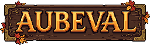
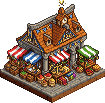
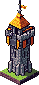
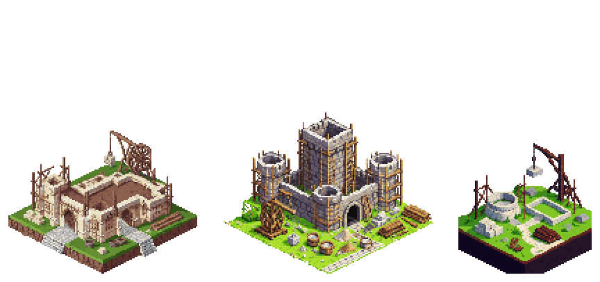
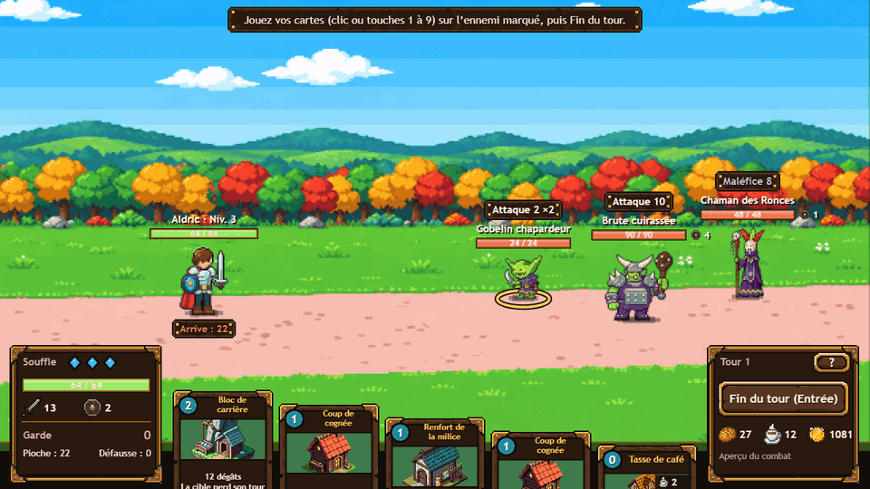
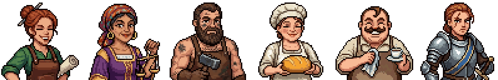
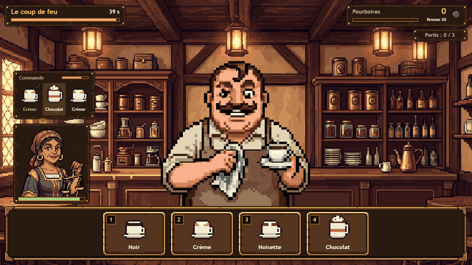
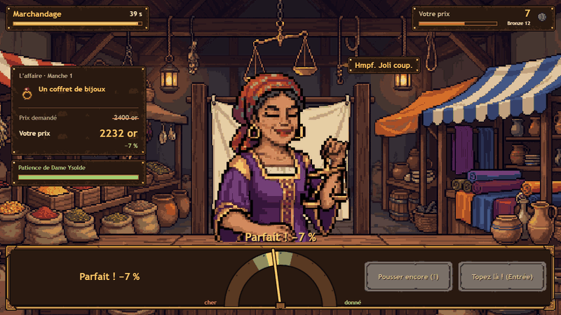
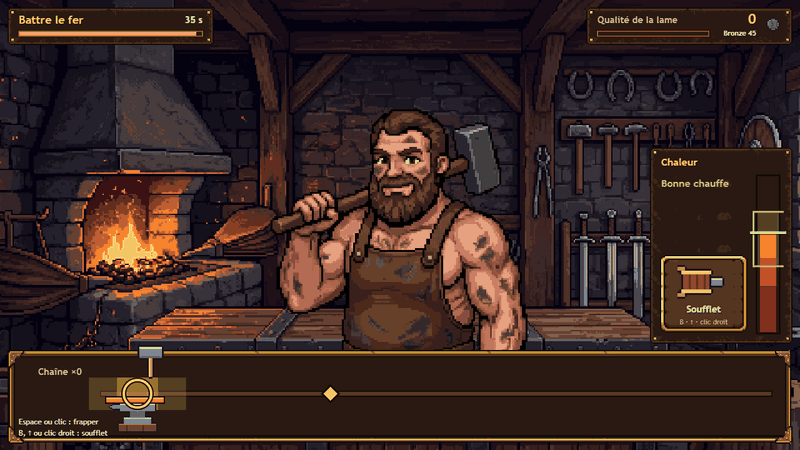

<div align="center">



### A village to build, a hero to arm.

A management and combat game in **isometric pixel art**, played in the browser.<br>
No dependencies, no build step: just HTML and JavaScript.

<br>


</div>

<br>

## The game

You are the mayor of Aubeval. Place buildings on a large generated map, different in every game, keep their production chains running (wood, planks, bread, coffee) and arm your hero to fend off goblin raids. The game has no end: the village grows, the city climbs in rank, and there is always one more project to build.

<div align="center">








</div>

## What you do

### Build a real town

- **Production chains**: each building feeds the next, and each must touch a path to work.
- **Citizens by class**, with their needs: houses, services within reach, neighbourhood beauty, roads, taxes and popularity.
- **Four visual tiers** per building (levels 1, 5, 10 and 15), and three styles to choose from for the house and the town hall.
- **Three great works** (cathedral, castle, great lighthouse) raised stage by stage, scaffolding included.
- Paths you lay by hand, trees you fell or plant, decoration, and walls you draw the way you would in a strategy game.

<div align="center">



</div>

### Arm your hero and hold the line

- **Turn-based card combat**: the cards come from the buildings of your village, and the **parry is played on timing** (Space or click when the ring touches the golden circle).
- **Raids** launched from a goblin camp, traps to set along their route, watchtowers and ramparts, and a safe zone around the town hall.
- **Soldiers to send** across the map to destroy the camp. A new, stronger one eventually rises in its place.
- **Warlords** who lead the sieges, and Grakk the Cleaver among the enemies.

<div align="center">



</div>

### People and places

The merchants, the blacksmith, the baker, the innkeeper, the captain and the guide Aveline each have an animated portrait. The Café, the Market and the Forge open full screen, with their own mini-games.

<div align="center">



<br><br>


</div>

Each place has a half-minute mini-game that gets harder with your winning streak. One click to watch them run:

<details>
<summary><b>The Café</b>: “The Rush”</summary>

<br>

Customers place their orders and their bubbles close: serve the right cups, in the right order.

<div align="center">



</div>

</details>

<details>
<summary><b>The Market</b>: “Haggling”</summary>

<br>

Stop the needle in the green zone, then push for a better price or shake on it.

<div align="center">



</div>

</details>

<details>
<summary><b>The Forge</b>: “Beating the Iron”</summary>

<br>

Strike when the markers cross the anvil, and keep the heat in its zone with the bellows.

<div align="center">



</div>

</details>

### Endless exploration

A large map of varied biomes, drawn at random for every new game and always playable, hidden under mist, with ruins, hamlets, deposits and lairs to discover. City ranks, citizen orders, great works, a legacy tree and a rising threat: hours of play.

### A tutorial that follows the game

Aveline guides your first steps, one at a time, then the lessons arrive just when you need them. The *Book of Lessons* gathers them all.

## Play

The game is static: serve the folder with any local HTTP server.

```sh
python -m http.server 8000
```

Then open <http://localhost:8000>. The game is saved in the browser (`localStorage`). Adding `?seed=123456` to the address starts a new game on that map.

## Controls

| Action | Control |
|---|---|
| Place, select | Click |
| Move the view | Drag |
| Zoom | Wheel |
| Cancel | Right-click |
| Start | Enter or click |
| Parry, in combat | Space or click |

The pause screen lists every control.

## Credits

The sprites are generated with [PixelLab](https://pixellab.ai).

The music comes from [OpenGameArt](https://opengameart.org), by mrpoly, Scott Elliott (Scrabbit), Cleyton Kauffman, RandomMind and Johan Brodd. Titles, licences and sources: [assets/music/CREDITS.md](assets/music/CREDITS.md).

## Licence

The code is under the MIT licence, see [LICENSE](LICENSE). The music in `assets/music/` keeps each author's own licence (CC0, CC BY 3.0 or CC BY 4.0), detailed in [assets/music/CREDITS.md](assets/music/CREDITS.md).
