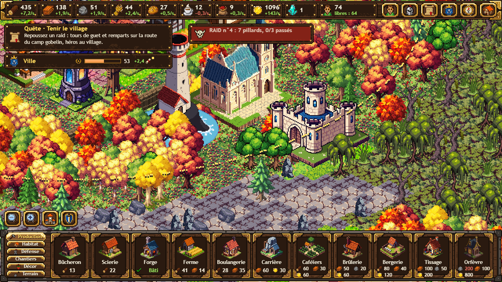
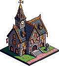
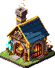
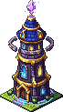
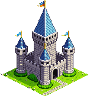
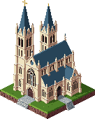
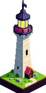
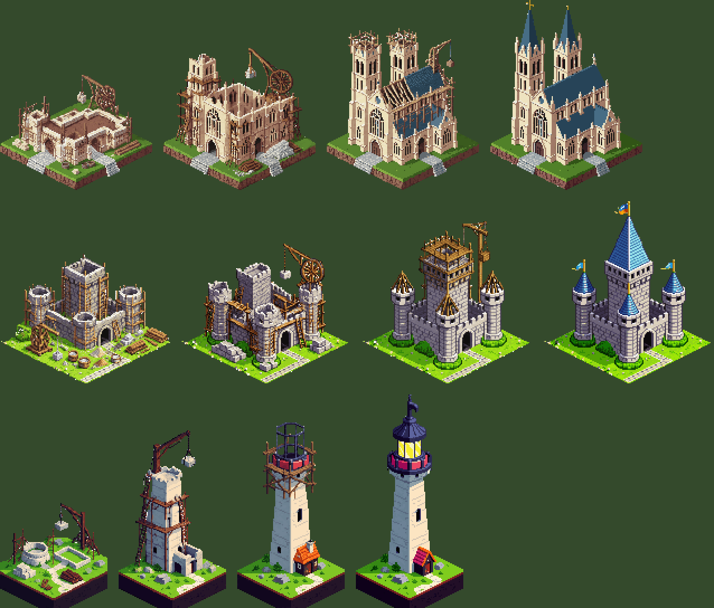
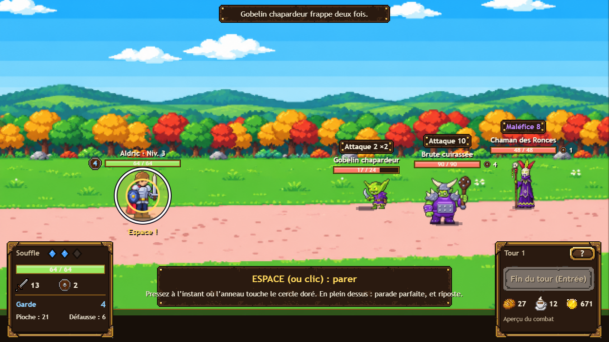
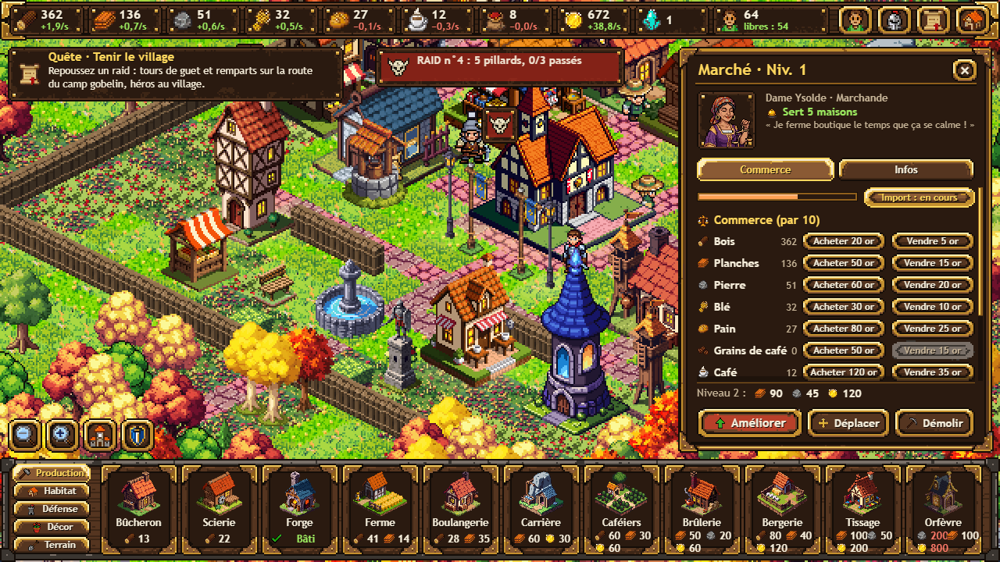

<div align="center">


### Un village à bâtir, un héros à armer.

Un jeu de gestion et de combat en **pixel art isométrique**, qui se joue dans le navigateur.<br>
Aucune dépendance, aucun build : du HTML et du JavaScript.

<br>



</div>

<br>

## Le jeu

Vous êtes le bourgmestre d'Aubeval. Posez des bâtiments sur une grande carte générée, faites tourner leurs chaînes de production (bois, planches, pain, café) et armez votre héros pour repousser les raids gobelins. La partie n'a pas de fin : le village grandit, la cité monte en rang et il y a toujours un chantier de plus.

<div align="center">










</div>

## Ce qu'on y fait

### Bâtir une vraie ville

- **Des chaînes de production** : chaque bâtiment nourrit le suivant, et chacun doit toucher un chemin pour travailler.
- **Des citoyens par classe**, avec leurs besoins : maisons, services à portée, beauté du quartier, routes, impôts et popularité.
- **Quatre paliers d'aspect** par bâtiment (niveaux 1, 5, 10 et 15), et trois styles au choix pour la maison et l'hôtel de ville.
- **Trois grands chantiers** (cathédrale, château, grand phare) élevés étape par étape, échafaudages compris.
- Des chemins que l'on trace à la main, des arbres que l'on abat ou que l'on plante, de la décoration, et des murs qui se tracent comme dans un jeu de stratégie.

<div align="center">



<sub>Cathédrale, château et grand phare, chacun en quatre étapes de chantier.</sub>

</div>

### Armer son héros et tenir bon

- **Un combat de cartes au tour par tour** : les cartes viennent des bâtiments du village, et la **parade se joue au timing** (Espace ou clic quand l'anneau touche le cercle doré).
- **Des raids** lancés depuis un camp gobelin, des pièges à poser sur leur route, des tours de guet et des remparts, une zone sûre autour de l'hôtel de ville.
- **Des soldats à envoyer** sur la carte pour détruire le camp. Un nouveau, plus fort, finit par se relever.
- **Des seigneurs de guerre** qui mènent les sièges, et Grakk le Fendeur parmi les ennemis.

<div align="center">



</div>

### Des gens, des lieux

Marchands, forgeron, boulangère, aubergiste, capitaine et guide Aveline ont leur portrait animé. Le Café, le Marché et la Forge s'entrent en plein écran, avec leurs mini-jeux.

<div align="center">


<br><br>



</div>

### Explorer sans fin

Une grande carte aux biomes variés, sous le brouillard, avec des ruines, des hameaux, des gisements et des antres à découvrir. Rangs de cité, commandes des citoyens, grandes œuvres, arbre d'héritage et menace qui monte : de quoi jouer des heures.

### Un tutoriel qui suit le jeu

Aveline guide les premiers pas, étape par étape, puis les leçons arrivent au bon moment. Le *Livre des leçons* les regroupe toutes.

## Jouer

Le jeu est statique : servez le dossier avec n'importe quel serveur HTTP local.

```sh
python -m http.server 8000
```

Puis ouvrez <http://localhost:8000>. La partie est sauvegardée dans le navigateur (`localStorage`).

## Commandes

| Action | Commande |
|---|---|
| Poser, choisir | Clic |
| Déplacer la vue | Glisser |
| Zoom | Molette |
| Annuler | Clic droit |
| Commencer | Entrée ou clic |
| Parer, en combat | Espace ou clic |

La pause liste toutes les commandes.

## Structure

```text
index.html        la page et le démarrage du jeu
config.js         toutes les valeurs d'équilibrage
data/             bâtiments, ennemis, quêtes, textes, tutoriel…
js/               les systèmes du jeu (village, combat, raids, ville…)
assets/           manifeste des images et sprites, icônes de l'appli (assets/icons)
docs/             captures d'écran de ce README
tools/            scripts de génération et de vérification
og-image.png      l'image d'aperçu des liens partagés (python tools/make_social.py)
manifest.webmanifest, robots.txt, sitemap.xml, 404.html   référencement et installation
```

## Crédits

Les sprites sont générés avec [PixelLab](https://pixellab.ai).

Les musiques viennent d'[OpenGameArt](https://opengameart.org), par mrpoly, Scott Elliott (Scrabbit), Cleyton Kauffman, RandomMind et Johan Brodd. Titres, licences et sources : [assets/music/CREDITS.md](assets/music/CREDITS.md).

## Licence

Le code est sous licence MIT, voir [LICENSE](LICENSE). Les musiques de `assets/music/` gardent chacune la licence de leur auteur (CC0, CC BY 3.0 ou CC BY 4.0), détaillée dans [assets/music/CREDITS.md](assets/music/CREDITS.md).
